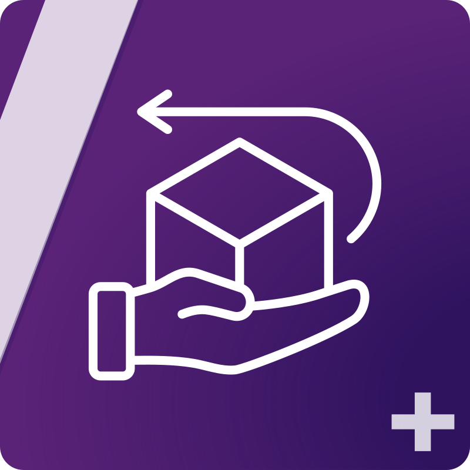

<p align="center">
    <a href="https://github.com/emagma/sylius-order-withdrawal-plugin/actions/workflows/ci.yml"></a>
    <a href="https://packagist.org/packages/emagma/sylius-order-withdrawal-plugin"></a>
    <a href="https://packagist.org/packages/emagma/sylius-order-withdrawal-plugin"></a>
    <a href="LICENSE"></a>
</p>

<h1 align="center">
    <br>
    Sylius Order Withdrawal Plugin
</h1>

<p align="center">
    A public withdrawal form for your Sylius shop — customers notify you that they are exercising
    their right of withdrawal, and you triage the requests from the admin panel.
</p>


## License

Released under the [MIT license](LICENSE). Sylius, the Sylius logo and the Sylius name are
trademarks of Sylius Sp. z o.o. — see
[LICENSE_OF_TRADEMARK_AND_LOGO](LICENSE_OF_TRADEMARK_AND_LOGO).

## Made with ❤️ by Emagma

**Emagma has been building bespoke e-commerce projects with Sylius for over ten years.** We provide
professional services to businesses adopting Sylius as their platform, with a highly experienced
team — Sylius **Premium Partner**, **Artisan Partner** and **Official Training Partner**.

Open-sourcing this plugin is how we give back to the ecosystem we build on every day.

## Professional services

Need some professional support for a Sylius project? Send us an email at **<sales@emagma.fr>** and
let us know how we can help — the people who answer you are the ones you will work with.

| | |
| --- | --- |
| **Consulting** | Platform choice, architecture and scoping, before you commit a budget |
| **Project audit & rescue** | Inherited codebase, stalled upgrade, a shop that won't hold peak traffic |
| **Technical team leadership** | A senior lead embedded in your team |
| **Training** | Official Sylius Training Partner — your developers productive, fast |

<p>
    <!-- emagma-padded.svg is the logo on a taller transparent canvas, so that at the same
         height="96" as the badges it reads at ~32px and sits vertically centred. GitHub strips
         CSS from READMEs, so the alignment lives in the asset rather than in a style attribute. -->
    <a href="https://www.emagma.fr"></a>
    &nbsp;
    
    &nbsp;
    
    &nbsp;
    
</p>

## Demo

<!-- TODO(media): drop the recorded assets in docs/media/ — see docs/media/README.md for the shot list. -->


| Shop form | Admin list | Admin detail |
| --- | --- | --- |
|  |  |  |

Everything above runs locally in two commands — see [Try it in one command](#try-it-in-one-command).

## What it does

Under EU consumer law ([Directive 2011/83/EU](https://eur-lex.europa.eu/eli/dir/2011/83/oj)), a
customer buying online has **14 days to withdraw** from the purchase. The shop must give them a way
to say so, and acknowledge it on a durable medium. This plugin is that mechanism.

- **A public form** at `/{locale}/withdrawal-request`, linked from the shop footer. No account, no
  login.
- **Full or partial** withdrawal, with a mandatory detail field when it is partial.
- **An acknowledgement email** to the customer, timestamped, sent on submission.
- **A notification email** to the shop, routed to the channel's contact email by default.
- **An admin screen** — a filterable grid, plus a detail page with three actions: take in charge,
  confirm, reject. Confirming emails the customer.
- **Channel- and locale-aware** — each request records where and in which language it came from.
- **Extensible** — a Symfony state machine, a domain event, a notifier interface, and overridable
  templates and emails.

### What it does *not* do

Being explicit here will save you an evaluation:

- It **does not link a request to a real Sylius order.** `orderNumber` is free text, typed by the
  customer. Nothing is checked against `sylius_order`.
- It **does not verify** that the order exists, that it belongs to the person submitting, or that
  the request falls inside the withdrawal window.
- It **does not refund, cancel or restock** anything, and it never touches the order state machine.

It is a **notification and triage tool**. The commercial and accounting side of a withdrawal stays
in your existing process; the plugin makes sure the request reaches you, is acknowledged in
writing, and does not get lost.

> **Not legal advice.** Installing this plugin does not make your shop compliant with any
> particular jurisdiction. The shipped wording is a starting point — have your own counsel review
> the legal notice, the form copy and your terms before going live.

## Requirements

| | Version |
| --- | --- |
| PHP | `^8.2` |
| Sylius | `^2.1` |
| Symfony | `7.4` (or `6.4`) |
| Database | MySQL / MariaDB (the shipped migration is MySQL-specific) |

No front-end build is required: the plugin ships no JavaScript and no compiled assets.

> The **`1.14`** branch targets Sylius `^1.14`. See [Branching](CONTRIBUTING.md#branching).

## Install

```bash
composer require emagma/sylius-order-withdrawal-plugin
```

Register the bundle in `config/bundles.php`:

```php
return [
    // ...
    Emagma\SyliusOrderWithdrawalPlugin\EmagmaSyliusOrderWithdrawalPlugin::class => ['all' => true],
];
```

Import the configuration and the routes:

```yaml
# config/packages/emagma_sylius_order_withdrawal.yaml
imports:
    - { resource: '@EmagmaSyliusOrderWithdrawalPlugin/config/config.yaml' }
```

```yaml
# config/routes/emagma_sylius_order_withdrawal.yaml
emagma_sylius_order_withdrawal:
    resource: '@EmagmaSyliusOrderWithdrawalPlugin/config/routes.yaml'
```

Then create the table:

```bash
bin/console doctrine:migrations:migrate -n
bin/console cache:clear
```

**Check it's up:** the shop footer shows a *Withdrawal request* link, and the admin menu shows
*Withdrawal requests* under **Customers**.

Full walk-through, verification steps and troubleshooting:
**[docs/usage/getting-started.md](docs/usage/getting-started.md)**.

## Try it in one command

A self-contained Docker image boots a Sylius shop with this plugin mounted, sample fixtures loaded,
and Mailpit capturing every outgoing email. No database, PHP or Node needed on your machine.

It builds from **this repository**, so clone it first — the image is for evaluating and developing
the plugin, not something you run from inside your own project:

```bash
git clone https://github.com/emagma/sylius-order-withdrawal-plugin.git
cd sylius-order-withdrawal-plugin
docker build -f docker/demo/Dockerfile --build-arg SYMFONY_VERSION="7.4.*" -t owp-demo .
docker run --rm -p 8080:80 -p 8025:8025 owp-demo
```

- Shop form → <http://localhost:8080/en_US/withdrawal-request>
- Admin → <http://localhost:8080/admin> (`sylius` / `sylius`)
- Emails → <http://localhost:8025>

Details in **[docker/demo/README.md](docker/demo/README.md)**.

## Documentation

**Using the plugin**

- [Getting started](docs/usage/getting-started.md) — install, verify, first request
- [The customer journey](docs/usage/customer-journey.md) — the form, field by field, and its validation rules
- [Admin guide](docs/usage/admin-guide.md) — the grid, the filters, the state machine
- [Emails](docs/usage/emails.md) — the three emails, who receives them, how to change them
- [Configuration reference](docs/usage/configuration.md) — every option and its default

**Extending the plugin**

- [Architecture](docs/dev/architecture.md) — what a request touches, and in what order
- [Extending](docs/dev/extending.md) — the entity, form, state machine, notifiers, events and templates
- [Translating](docs/dev/translating.md) — add a locale, override a single label
- [Testing](docs/dev/testing.md) — PHPUnit, the four Behat suites, static analysis
- [Demo image](docker/demo/README.md) — the Docker demo, for evaluation or screenshots

[Changelog](CHANGELOG.md) · [Upgrade guide](UPGRADE.md) · [Contributing](CONTRIBUTING.md)

## Translating

The plugin ships **English** and **French** for messages, validation errors and flash messages.

Adding a locale is one file per domain in your application's `translations/`, with no code involved
— see [docs/dev/translating.md](docs/dev/translating.md). Translation contributions are very
welcome; open a pull request with the new files.

## Contributing

Issues and pull requests are welcome. Please read **[CONTRIBUTING.md](CONTRIBUTING.md)** first — it
covers which branch to target (there is one per Sylius line), the quality gate your PR has to pass,
and how to run the test suites locally.

GitHub issues are the place for **bugs and feature requests**; for hands-on help, see Support below.

## Support

This plugin is released under the MIT license, which means it comes **without warranty or
liability** — validating it for your own shop and your own jurisdiction is on you.

That said, we use it ourselves and we care about it. We read what comes in, and we do our best to
process feedback, fix bugs and review pull requests that keep the spirit of the plugin: simple,
customisable, and focused on notifying and triaging withdrawal requests rather than becoming a
returns engine. We can't promise a timeline — this is shared work on top of client projects — but
your report won't fall into a void.

| I want to… | Go to |
| --- | --- |
| Report a bug or request a feature | [GitHub issues](../../issues), with a reproduction |
| Ask the community for help | [Sylius Slack](https://sylius.com/slack) |
| Get pro support | <support@emagma.fr> — French native, English best effort |
| Report a security vulnerability | <security@emagma.fr> — privately, never a public issue ([policy](SECURITY.md)) |

For installation help, integration questions or "how do I…?", the Sylius Slack will usually get you
an answer faster than an issue here — that's where the whole community is.

