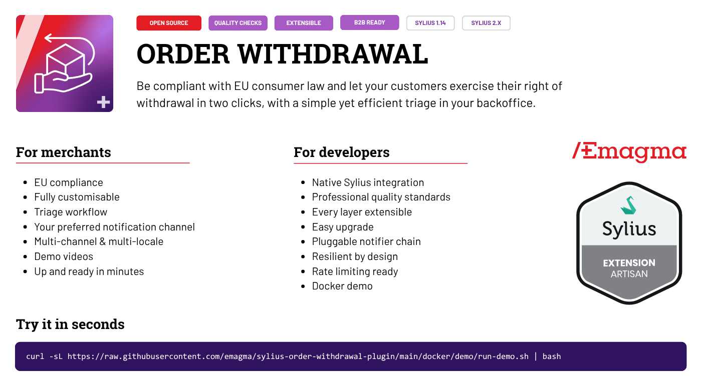
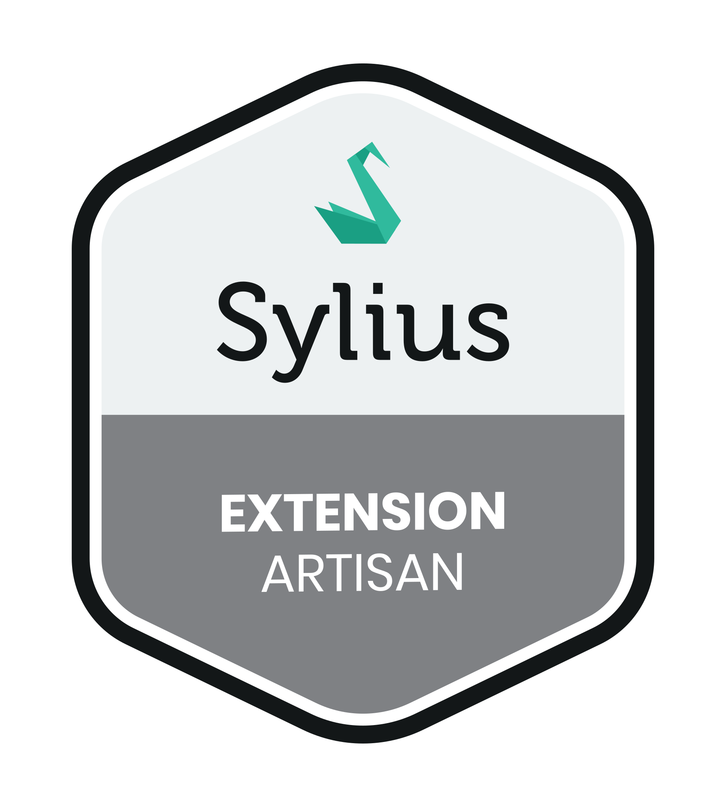
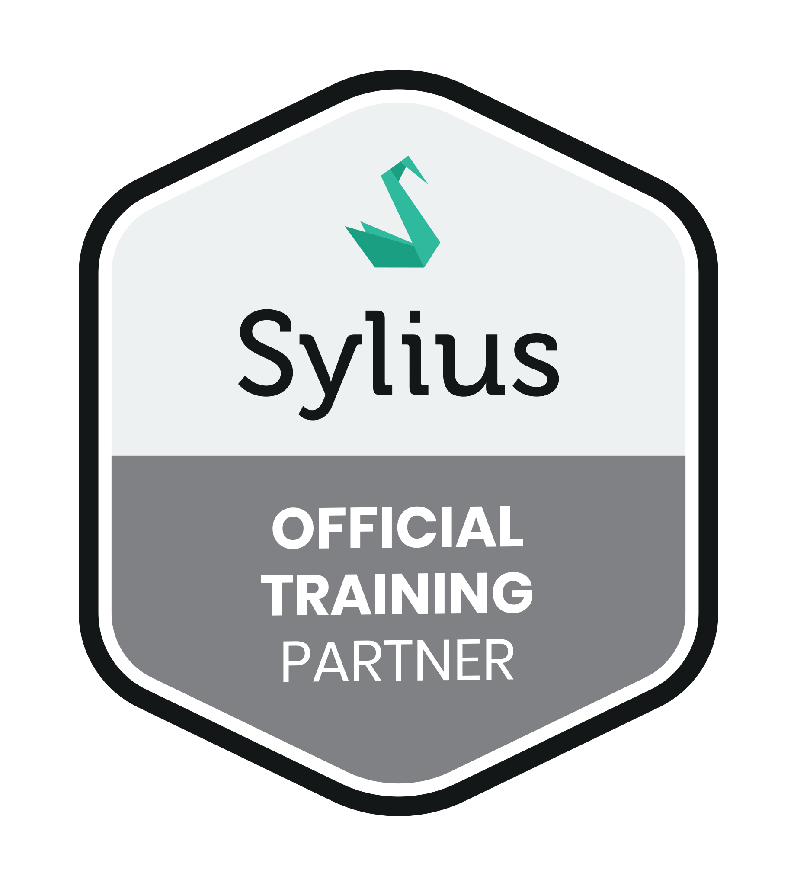
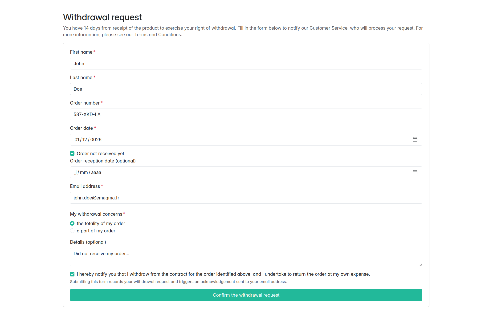
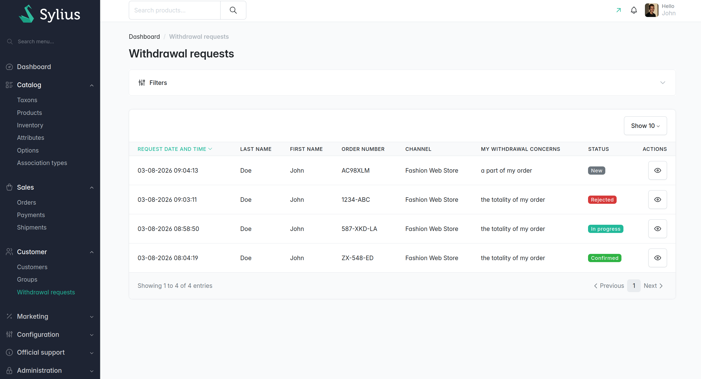
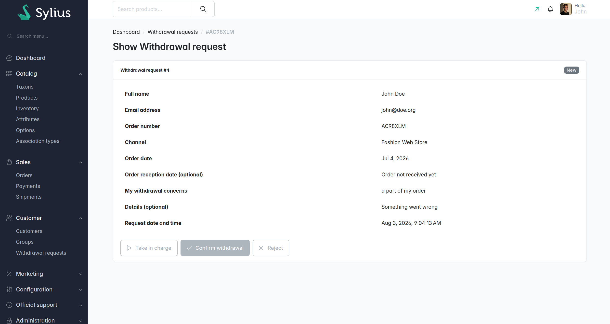

<p align="center">
    <a href="https://github.com/emagma/sylius-order-withdrawal-plugin/actions/workflows/ci.yml"></a>
    <a href="https://packagist.org/packages/emagma/sylius-order-withdrawal-plugin"></a>
    <a href="https://packagist.org/packages/emagma/sylius-order-withdrawal-plugin"></a>
    <a href="LICENSE"></a>
</p>

<h1 align="center">
    Sylius Order Withdrawal Plugin
</h1>

<p align="center">
 Be compliant with EU consumer law and let your customers exercise their right of withdrawal in two clicks, with a simple yet efficient triage in your backoffice.
</p>

<div style="margin: 0 auto; max-width: 1200px;">
    
</div>


## License

Released under the [MIT license](LICENSE).

The Emagma registered trademark, the Emagma logo and all Emagma artwork
are **not** covered by the MIT license — see [TRADEMARK.md](TRADEMARK.md)
for permitted use.

Sylius, the Sylius logo and the Sylius name are trademarks of
Sylius Sp. z o.o. — see the
[Sylius trademark policy](https://github.com/Sylius/Sylius/blob/master/LICENSE_OF_TRADEMARK_AND_LOGO).

## Made with ❤️ by Emagma

**Emagma has been building bespoke e-commerce projects with Sylius for over ten years.** We provide
professional services to businesses adopting Sylius as their platform, with a highly experienced
team — Sylius **Premium Partner**, **Artisan Partner** and **Official Training Partner**.

Open-sourcing this plugin is how we give back to the ecosystem we build on every day.

Emagma is a French company based in Toulouse. IT and AI have a real impact on people, society and
the environment, and that matters to us. We hold strong values — you can
[read more about them](etc/emagma/emagma.md).

More about us at [emagma.fr](https://www.emagma.fr), on our
[Sylius partner page](https://sylius.com/partner/emagma/), or by email at
<info@emagma.fr>.

## Professional services

Need some professional support for a Sylius project? Send us an email at **<info@emagma.fr>** and
let us know how we can help — the people who answer you are the ones you will work with.

| | |
| --- | --- |
| **Consulting** | Platform choice, architecture and scoping, before you commit a budget |
| **Project audit & rescue** | Inherited codebase, stalled upgrade, a shop that won't hold peak traffic |
| **Technical team leadership** | A senior lead embedded in your team |
| **Training** | Official Sylius Training Partner — your developers productive, fast |

<p>
    <a href="https://www.emagma.fr"></a>
    &nbsp;
    
    &nbsp;
    
    &nbsp;
    
</p>

## Demo

| Shop form | Admin list | Admin detail |
| --- | --- | --- |
|  |  |  |

> Video walkthroughs: [shop demo](https://drive.google.com/file/d/1LzrS_3v5QkAXX7EPnRV8rqx4zeMfoXCM/view) · [backoffice demo](https://drive.google.com/file/d/1bbG9A2f5cqvAu7UmFJqd-cfHei8ooUT9/view)

Everything above runs locally — see [Try it locally](#try-it-locally).

## What it does

Under EU consumer law ([Directive 2011/83/EU](https://eur-lex.europa.eu/eli/dir/2011/83/oj)), a
customer buying online has **14 days to withdraw** from the purchase. The shop must give them a way
to say so, and acknowledge it on a durable medium. This plugin is that mechanism.

- **A public form** at `/{locale}/withdrawal-request`, linked from the shop footer. No account, no
  login.
- **Full or partial** withdrawal, with a mandatory detail field when it is partial.
- **An acknowledgement email** to the customer, timestamped, sent on submission.
- **A notification email** to the shop, routed to the channel's contact email by default.
- **An admin screen** — a filterable grid, plus a detail page with three actions: take in charge,
  confirm, reject. Confirming emails the customer.
- **Channel- and locale-aware** — each request records where and in which language it came from.
- **Extensible** — a Symfony state machine, a domain event, a notifier interface, and overridable
  templates and emails.

### What it does *not* do

Being explicit here will save you an evaluation:

- It **does not link a request to a real Sylius order.** `orderNumber` is free text, typed by the
  customer. Nothing is checked against `sylius_order`.
- It **does not verify** that the order exists, that it belongs to the person submitting, or that
  the request falls inside the withdrawal window.
- It **does not refund, cancel or restock** anything, and it never touches the order state machine.
- It **does not protect the public form** against automated submission. No CAPTCHA, no honeypot, no
  bot detection — see the warning below.

It is a **notification and triage tool**. The commercial and accounting side of a withdrawal stays
in your existing process; the plugin makes sure the request reaches you, is acknowledged in
writing, and does not get lost.

> **⚠️ The form is a public mail trigger. Guard it before you go live.**
> `/withdrawal-request` is anonymous by design, and every accepted submission sends **two** emails:
> one to the shop, and one to the address the visitor typed in — an address the plugin never
> verifies. Left unguarded, that is a script away from making **your shop deliver attacker-chosen
> mail to attacker-chosen recipients**, which costs you bounce rates, spam complaints and, quickly
> enough, a blocklisted sending domain.
>
> **The plugin ships nothing that prevents this by default.** It defines no rate limiter of its
> own — it ships the listener and a `rate_limiter_service` key, and you point that at a limiter
> your app declares under `framework.rate_limiter`. Unset, which is the default, nothing throttles
> the form; and even once set, it does nothing useful behind a proxy or CDN until
> `framework.trusted_proxies` is configured. Anything beyond it — CAPTCHA, WAF rules, CDN bot
> management, or `send_acknowledgement: false` to remove the attacker-controlled recipient — is
> yours to add.
>
> Read [the public endpoint](SECURITY.md#public-endpoint) before deploying to a public shop.

> **Not legal advice.** Installing this plugin does not make your shop compliant with any
> particular jurisdiction. The shipped wording is a starting point — have your own counsel review
> the legal notice, the form copy and your terms before going live.

## Requirements

| | Version |
| --- | --- |
| PHP | `^8.2` |
| Sylius | `~2.0.0 \|\| ~2.1.0 \|\| ~2.2.0` |
| Symfony | `7.4` (or `6.4`) |
| Database | MySQL / MariaDB / PostgreSQL — the same platforms Sylius core supports. Two migrations ship, one per platform, each skipping on the other. |
| DB connection charset | **MySQL/MariaDB only:** `utf8mb4` — a `utf8`/`utf8mb3` DBAL connection will reject 4-byte characters (emoji, many CJK) even though the plugin's own table is `utf8mb4`. PostgreSQL databases are UTF-8 throughout, so nothing to configure. |

No front-end build is required: the plugin ships no JavaScript and no compiled assets. It does ship
empty Webpack Encore entrypoints for your own additions — see
[Front-end assets](docs/developer-guide.md#front-end-assets) in the developer guide.

> The **`1.0.x-dev`** branch targets Sylius `^1.14.0`. See [Branching](CONTRIBUTING.md#branching).

## Install

```bash
composer require emagma/sylius-order-withdrawal-plugin
```

Register the bundle in `config/bundles.php`:

```php
return [
    // ...
    Emagma\SyliusOrderWithdrawalPlugin\EmagmaSyliusOrderWithdrawalPlugin::class => ['all' => true],
];
```

Import the configuration and the routes:

```yaml
# config/packages/emagma_sylius_order_withdrawal.yaml
imports:
    - { resource: '@EmagmaSyliusOrderWithdrawalPlugin/config/config.yaml' }
```

```yaml
# config/routes/emagma_sylius_order_withdrawal.yaml
emagma_sylius_order_withdrawal:
    resource: '@EmagmaSyliusOrderWithdrawalPlugin/config/routes.yaml'
```

The plugin ships no Flex recipe, so both imports are manual. The single `config.yaml` pulls in the
resource definition, the grid, the mailer templates, the state machine and the Twig hooks; the
single `routes.yaml` mounts both sides:

| Side | Prefix | What it adds |
| --- | --- | --- |
| Shop | `/{_locale}` | `GET` and `POST` on `/withdrawal-request` |
| Admin | `/%sylius_admin.path_name%` | the grid, the detail page and the three transition endpoints |

Then create the table:

```bash
bin/console doctrine:migrations:migrate -n
bin/console cache:clear
```

**Check it's up:** the shop footer shows a *Withdrawal request* link, and the admin menu shows
*Withdrawal requests* under **Customers**.

```bash
bin/console debug:router | grep emagma_sylius_order_withdrawal
bin/console doctrine:query:sql "SELECT COUNT(*) FROM emagma_order_withdrawal_request"
```

<details>
<summary><strong>If something doesn't show up</strong></summary>

**The footer link doesn't appear.** It is injected through a Twig hook chosen by the installed
Sylius version — `sylius_shop.base.footer.content.menu.help_links` on Sylius 2.2 and later,
`sylius_shop.base.footer.content` before that. If your theme overrides the shop footer without
rendering that hook, add the link yourself:

```twig
<a href="{{ path('emagma_sylius_order_withdrawal_shop_request') }}">
    {{ 'emagma_sylius_order_withdrawal.shop.footer_link'|trans }}
</a>
```

**The admin menu entry doesn't appear.** `AdminMenuListener` adds it under the `customers` child,
creating that child if your menu has none. A menu built from scratch by another listener can
displace it — check the order of your `sylius.menu.admin.main` listeners.

**"No route found for GET /withdrawal-request".** The shop route is prefixed with `/{_locale}`, so
it lives at `/en_US/withdrawal-request`, not at the bare path.

**Labels show as raw keys** (`emagma_sylius_order_withdrawal.shop.title`). Clear the cache; if it
persists, your locale has no translation file — see the
[developer guide](docs/developer-guide.md#translating).

</details>

Full walk-through and usage details: [docs/user-guide.md](docs/user-guide.md).

## Try it locally

A self-contained Docker image boots a Sylius shop with this plugin mounted, sample fixtures loaded,
and Mailpit capturing every outgoing email. No database, PHP or Node needed on your machine.

It builds from **this repository**, so clone it first. The image is for evaluating and developing
the plugin — not something you run from inside your own project, and never something to run in
production:

```bash
git clone https://github.com/emagma/sylius-order-withdrawal-plugin.git
cd sylius-order-withdrawal-plugin
docker build -f docker/demo/Dockerfile --build-arg SYMFONY_VERSION="7.4.*" -t emagma/owp-demo .
docker run --rm -p 8080:80 -p 8025:8025 emagma/owp-demo
```

- Shop form → <http://localhost:8080/en_US/withdrawal-request>
- Admin → <http://localhost:8080/admin> (`sylius` / `sylius`)
- Emails → <http://localhost:8025>

Details in [docker/demo/README.md](docker/demo/README.md).

## Documentation

**Using the plugin**

- [User guide](docs/user-guide.md) — the form, the emails, the admin panel, the request lifecycle
  and the configuration reference

**Extending the plugin**

- [Developer guide](docs/developer-guide.md) — architecture, extension points, front-end assets,
  translating, testing
- [Demo image](docker/demo/README.md) — the Docker demo, for evaluation or screenshots

[Changelog](CHANGELOG.md) · [Upgrade guide](UPGRADE.md) · [Contributing](CONTRIBUTING.md)

## Translating

The plugin ships **English** and **French** for messages, validation errors and flash messages.

Adding a locale is one file per domain in your application's `translations/`, with no code involved
— see the [developer guide](docs/developer-guide.md#translating). Translation contributions are
very welcome; open an issue with the new files attached.

## Contributing

Contributions come in as **issues**, from humans and agents alike: describe the problem and the
change you propose, and a maintainer takes it from there. Pull requests are open to collaborators
only. [CONTRIBUTING.md](CONTRIBUTING.md) explains what makes a good proposal.

GitHub issues are the place for **bugs and feature requests**; for hands-on help, see Support below.

## Support

This plugin is released under the MIT license, which means it comes **without warranty or
liability** — validating it for your own shop and your own jurisdiction is on you.

That said, we use it ourselves and we care about it. We read what comes in, and we do our best to
process feedback, fix bugs and implement proposals that keep the spirit of the plugin: simple,
customisable, and focused on notifying and triaging withdrawal requests rather than becoming a
returns engine. We can't promise a timeline — this is shared work on top of client projects — but
your report won't fall into a void.

You can also contact our pro support at <support@emagma.fr> for priority help on your own project.
Paying us for consulting is a way to encourage our efforts in open-sourcing this plugin.

| I want to… | Go to |
| --- | --- |
| Report a bug or request a feature | [GitHub issues](../../issues), with a reproduction |
| Ask the community for help | [Sylius Slack](https://sylius.com/slack) |
| Get pro support | <support@emagma.fr> — French native, English best effort |
| Report a security vulnerability | <security@emagma.fr> — privately, never a public issue ([policy](SECURITY.md)) |

For installation help, integration questions or "how do I…?", the Sylius Slack will usually get you
an answer faster than an issue here — that's where the whole community is.
