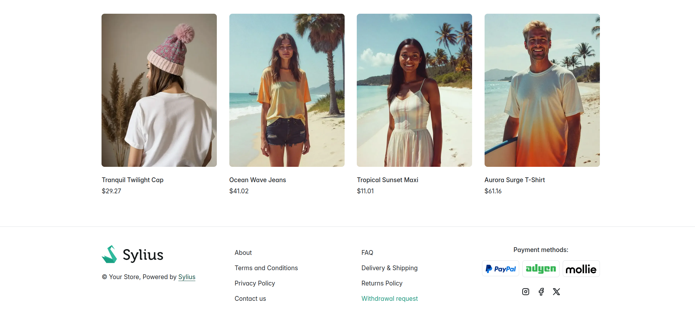
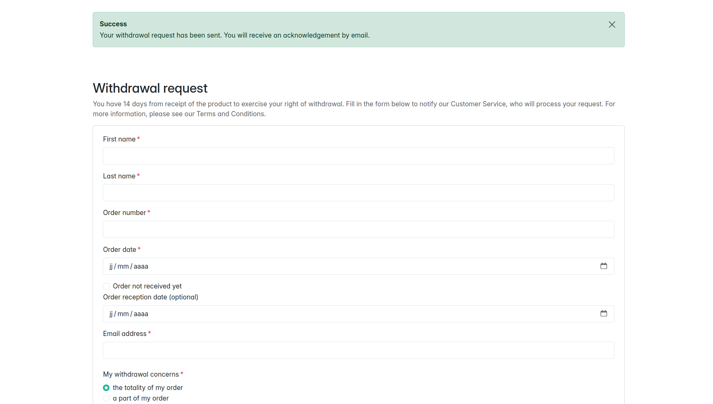
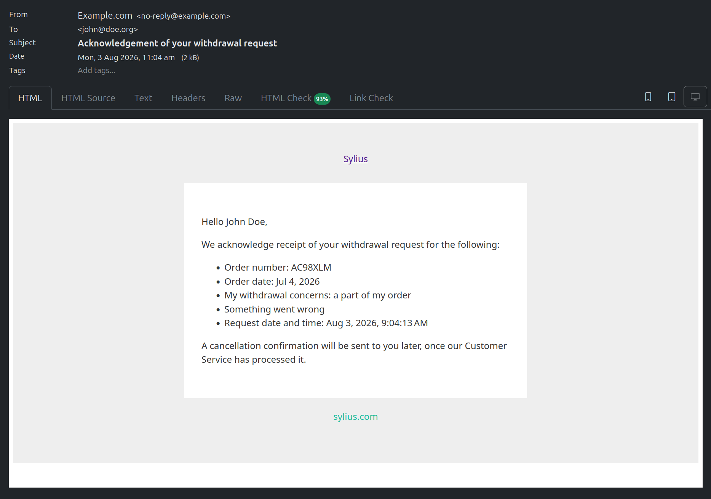
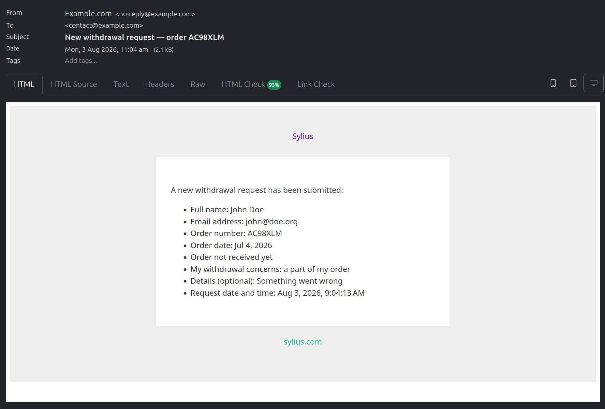

# User guide

| I want to…                       | Go to |
|----------------------------------| --- |
| Install the plugin               | [README → Install](../README.md#install) |
| Understand what customers see    | [The withdrawal form](#the-withdrawal-form) |
| Know what emails are sent        | [Emails](#emails) |
| Process incoming requests        | [The admin panel](#the-admin-panel) |
| Understand the request lifecycle | [Request lifecycle](#request-lifecycle) |
| Configure where notifications go | [Configuration](#configuration) |
| Customize further                | [Developer guide](developer-guide.md) |

> See the plugin in action: [shop demo](https://drive.google.com/file/d/1LzrS_3v5QkAXX7EPnRV8rqx4zeMfoXCM/view) · [backoffice demo](https://drive.google.com/file/d/1bbG9A2f5cqvAu7UmFJqd-cfHei8ooUT9/view)

## What the plugin does

The plugin adds a **public withdrawal form** to your Sylius storefront. Customers use it to notify
you they are exercising their right of withdrawal — as required under EU consumer law
([Directive 2011/83/EU](https://eur-lex.europa.eu/eli/dir/2011/83/oj)). You then triage these
requests from the admin panel.

In short:

- A form at `/{locale}/withdrawal-request`, linked from the shop footer. No account or login
  needed.
- An **acknowledgement email** to the customer on submission — the "durable medium" the directive
  asks for.
- A **notification email** to the shop, so the request does not get lost.
- An **admin screen** to list, filter and process requests.
- A **confirmation email** to the customer when you accept the withdrawal.

### What it does *not* do

- It **does not link a request to a real Sylius order.** The order number is free text typed by the
  customer — nothing is checked against your order database.
- It **does not refund, cancel or restock** anything, and it never touches the order workflow.
- It **does not verify** that the request falls inside the withdrawal window.

It is a **notification and triage tool**. The commercial and accounting side of a withdrawal stays
in your existing process.

> **Not legal advice.** Installing this plugin does not make your shop compliant with any particular
> jurisdiction. Have your own counsel review the legal notice and form copy before going live.

## The withdrawal form

The form lives at `/{locale}/withdrawal-request` and is linked from the shop footer on every page.



No account is required — a customer who checked out as a guest, or lost their account, can still
submit.


### Fields

| Field | Required | Notes |
| --- | --- | --- |
| First name | yes | |
| Last name | yes | |
| Order number | yes | Free text — not matched against a real order. |
| Order date | yes | Cannot be in the future. |
| Order not received yet | no | Checkbox, for withdrawing before delivery. |
| Order reception date | no | Cannot be in the future. |
| Email address | yes | The acknowledgement goes here. |
| My withdrawal concerns | yes | *The totality of my order* or *a part of my order*. |
| Details | conditional | Required when the withdrawal is partial. |
| Legal notice | yes | Must be ticked — this is the withdrawal statement. |

The legal notice checkbox carries the withdrawal statement itself — by default:

> I hereby notify you that I withdraw from the contract for the order identified above, and I
> undertake to return the order at my own expense.

This is a translation key, so rewording it for your jurisdiction is a one-liner — see the
[developer guide](developer-guide.md#translating).

The form re-renders with an error — nothing is recorded — when a required field is blank, the email
is invalid, a date is in the future, a partial withdrawal has no detail, or the legal notice is not
ticked.

### After submitting

Three things happen in order:

1. The request is saved in state **New**, stamped with the current time, channel and locale.
2. An **acknowledgement email** goes to the customer — timestamped, recapping the request.
3. A **notification email** goes to the shop.

The customer sees a confirmation message and an empty form. From their point of view, the exchange
continues by email.



## Emails

The plugin sends three emails, all through Sylius's own mailer.

| Email | When | To |
| --- | --- | --- |
| **Acknowledgement** | customer submits the form | the customer |
| **Notification** | customer submits the form | the shop ([configurable](#configuration)) |
| **Confirmation** | an administrator confirms the request | the customer |

| Acknowledgement email | Notification email (to the shop) |
| --- | --- |
|  |  |

**Rejecting** a request sends no email. The plugin deliberately leaves rejection replies to a human,
because refusing a statutory right usually needs a reasoned, individual response rather than a
template.

All emails are sent in the **locale the request was submitted in**, not the locale of whoever
triggers the send.

Email templates and wording can all be customised — see the
[developer guide](developer-guide.md).

## The admin panel

Everything lives under **Customers → Withdrawal requests**.

### The grid


A filterable list of all submitted requests, newest first.

| Column | |
| --- | --- |
| Request date | when the customer submitted |
| Last name / First name | who |
| Order number | as typed by the customer |
| Channel | which shop the request came from |
| My withdrawal concerns | totality or partial |
| Status | coloured badge |

**Filters:** last name, order number, status, channel, submission date.

Requests are created by customers, never by administrators. There is no edit or delete action — a
withdrawal notification is a record of something a customer told you.

### The detail page


Shows everything the customer submitted, including the fields the grid leaves out: the email
address, the reception date (or *Order not received yet*), and the free-text detail on a partial
withdrawal. Below the details sit the action buttons available in the request's current state — a
button only appears when the transition is legal.

### Permissions

The admin routes are declared with `permission: true`, so they go through Sylius's standard
authorisation layer. If you run an ACL/RBAC plugin, the withdrawal routes are governed by it like
any other admin resource.

## Request lifecycle

A request moves through a state machine. The diagram below shows every state and transition.

```
          ┌─── confirm ──────────────────┐
          │                              ▼
        ┌─┴─┐        ┌─────────────┐  confirm  ┌───────────┐
   ──►  │new│─start─►│ in_progress │─────────►│ confirmed │
        └─┬─┘        └──────┬──────┘          └───────────┘
          │                 │
          └─── reject ──┐   │ reject
                        ▼   ▼
                    ┌──────────┐
                    │ rejected │
                    └──────────┘
```

| State | Meaning |
| --- | --- |
| **New** | Just submitted. Nobody has looked at it yet. |
| **In progress** | Someone has taken it in charge. |
| **Confirmed** | The withdrawal is accepted. A confirmation email is sent to the customer. |
| **Rejected** | The withdrawal is refused. No email is sent. |

| Action | From | To |
| --- | --- | --- |
| Take in charge | New | In progress |
| Confirm withdrawal | New, In progress | Confirmed |
| Reject | New, In progress | Rejected |

- **You can confirm or reject straight from New.** Taking a request in charge is optional — useful
  for teams that want to show a request is being handled, not a mandatory step.
- **Confirmed and Rejected are terminal.** There is no transition out of them. If you need one, it
  can be added — see the [developer guide](developer-guide.md#the-state-machine).

## Configuration

Two settings control where the notification email goes, one controls whether the customer
acknowledgement is sent at all, and one names a rate limiter for the public form.

```yaml
# config/packages/emagma_sylius_order_withdrawal.yaml
emagma_sylius_order_withdrawal:
    notification_email: 'returns@example.com'
    prefer_channel_contact_email: true
    send_acknowledgement: true
    rate_limiter_service: null
```

| Setting | Default | Effect |
| --- | --- | --- |
| `notification_email` | `null` | Fallback address for shop-side notifications. Optional: leave it unset when `prefer_channel_contact_email` is on and every channel carries a contact email. With no channel address and no `notification_email`, nothing is sent to the shop — the request is still recorded, and the customer acknowledgement still goes out. |
| `prefer_channel_contact_email` | `true` | When on, a request routes to the contact email of the channel it came from, and to `notification_email` only when that channel has none. When off, every request routes to `notification_email` regardless of channel. Turn it off when one team handles every channel. |
| `send_acknowledgement` | `true` | Send an acknowledgement email to the address supplied on the public form. That address is never verified, so turn this off if you do not want your shop sending mail to unverified recipients. |
| `rate_limiter_service` | `null` | Service id of a `RateLimiterFactory` that throttles `POST` on the public form, returning HTTP 429 past its limit. **Left null, submissions are not throttled at all.** If you run a public shop you should set it — the endpoint is anonymous and every accepted submission sends mail. |

### Where a notification actually goes

The two settings are independent — `notification_email` is a fallback, not something you unlock by
turning `prefer_channel_contact_email` off. All four combinations are valid:

| `prefer_channel_contact_email` | Channel's contact email | Notification goes to |
| --- | --- | --- |
| `true` (default) | set | the channel's contact email |
| `true` (default) | empty, or the request has no channel | `notification_email` |
| `false` | set | `notification_email` |
| `false` | empty | `notification_email` |

So `notification_email` is still used under the default `true` whenever the originating channel has
no contact email. That is a real case, not a theoretical one: Sylius maps `Channel::contactEmail` as
nullable and validates it only for length and format, so a channel saved with the field left blank is
perfectly valid. Setting `prefer_channel_contact_email: false` does not enable `notification_email`;
it makes it unconditional.

The only combination that sends nothing shop-side is an unset `notification_email` together with no
usable channel address. The request is still recorded and still visible in the admin grid, and the
customer acknowledgement still goes out — but no one is told. If you leave `notification_email`
unset, make sure every channel carries a contact email.

`notification_email` accepts an environment variable. Write it with a default so an unset variable
resolves to no address instead of throwing `EnvNotFoundException` at runtime:

```yaml
emagma_sylius_order_withdrawal:
    notification_email: '%env(default::WITHDRAWAL_NOTIFICATION_EMAIL)%'
```

The address format is only checked for literal values — an env-provided address reaches the mailer
unvalidated, because the container is built before the variable is read.

Routing beyond these two settings — a distribution list, per-country routing, a CRM lookup — is a
matter of implementing `RecipientResolverInterface`; see the
[developer guide](developer-guide.md#emails-and-recipients).

### Throttling the public form

The plugin defines no rate limiter of its own. It ships the listener that knows the route and
turns a rejected submission into a 429, and you point it at a limiter your application declares
under [`framework.rate_limiter`](https://symfony.com/doc/current/rate_limiter.html) — which is
where the policy, the storage and the lock actually belong:

```bash
composer require symfony/rate-limiter symfony/lock
```

```yaml
# config/packages/rate_limiter.yaml
framework:
    rate_limiter:
        withdrawal_request:
            policy: 'sliding_window'
            limit: 5
            interval: '1 hour'
            # cache_pool: 'cache.redis_rate_limiter'   # see below
```

```yaml
# config/packages/emagma_sylius_order_withdrawal.yaml
emagma_sylius_order_withdrawal:
    rate_limiter_service: 'limiter.withdrawal_request'
```

Symfony names the generated service `limiter.<name>`. Setting `rate_limiter_service` without
`symfony/rate-limiter` installed fails the container build with an actionable error rather than
silently leaving the form unprotected. If you would rather not install `symfony/lock`, set
`lock_factory: null` on the limiter — without a lock, a fixed or sliding window can let a few
extra requests through under concurrency.

Two things decide whether the limit means anything in production:

- **The storage must be shared between your application servers.** `framework.rate_limiter`
  defaults to the `cache.rate_limiter` pool, which is filesystem-backed unless you say otherwise.
  On more than one server that gives each node its own buckets and multiplies the effective limit
  by the number of servers — point `cache_pool` at a pool using the [Redis
  adapter](https://symfony.com/doc/current/components/cache/adapters/redis_adapter.html) instead.
- **The client IP must be the real one.** The listener keys buckets on
  `Request::getClientIp()`. Behind any reverse proxy, load balancer or CDN, Symfony ignores the
  client's real IP unless you configure
  [`framework.trusted_proxies`](https://symfony.com/doc/current/deployment/proxies.html) — without
  it, every visitor resolves to the proxy's address and shares a single bucket, so 5 real
  customers, not 5 per attacker, exhaust the limit.

Everything else — templates, translations, form fields, states — is customised through Symfony's
standard extension points, documented in the [developer guide](developer-guide.md).

## Going further

The plugin is designed to be extended. The developer guide covers adding states and transitions,
reacting to submissions, adding notification channels, overriding templates, extending the form and
the entity, and translating to new locales.

→ **[Developer guide](developer-guide.md)**

Need professional help with your Sylius project? Emagma provides consulting, audits and training
as a Sylius Premium Partner. See [Professional services](../README.md#professional-services) or
contact **info@emagma.fr**.
